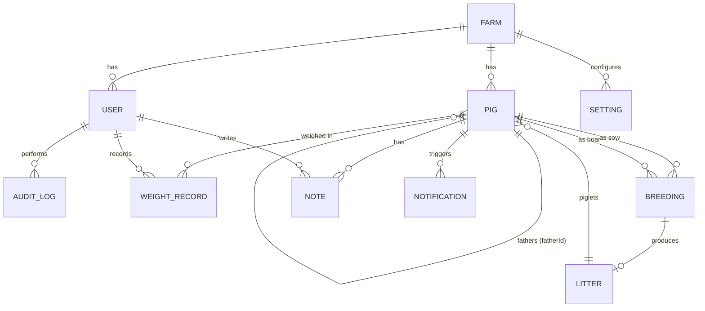

# Pig Farm Management Dashboard — Design & Architecture Plan

Status: **awaiting approval** — no implementation code exists yet.
Author: Claude (senior full-stack design pass)
Date: 2026-07-08

---

## 1. Software Architecture

**Stack**

| Layer | Choice | Rationale |
|---|---|---|
| Framework | **Next.js 15 (App Router) + TypeScript** | One deployable unit, server components for fast dashboards, API routes for mobile/RFID clients later |
| Database | **PostgreSQL** (SQLite via same Prisma schema for local dev) | Relational integrity for lineage/breeding; scales to multi-farm |
| ORM | **Prisma** | Strong typing end-to-end, migrations, easy schema evolution |
| Auth | **Auth.js (NextAuth v5)** — credentials provider, bcrypt, JWT sessions | Self-hosted farms need offline-friendly auth; no third-party dependency |
| Validation | **Zod** — single schema shared by client forms and server actions | No duplicated validation logic |
| UI | **Tailwind CSS + shadcn/ui + Radix primitives** | Accessible, professional SaaS look, dark/light theming built in |
| Tables | **TanStack Table v8** | Sorting, filtering, pagination, column visibility, row selection |
| Server state | **TanStack Query v5** | Cache, optimistic updates, background refetch |
| Client UI state | **Zustand** (modals, quick-add queue, table prefs) | Tiny, no boilerplate |
| Charts | **Recharts** | Composable analytics |
| CSV | **PapaParse** | Import/export |

**Architecture style** — a layered modular monolith:

```
UI (pages/components)
   → Server Actions / API routes        (thin: auth check → Zod parse → service call)
      → Service layer (src/server/services/*)   ← ALL business rules live here
         → Repository layer (Prisma)             ← ALL DB access lives here
```

Key principles:
- **Derived fields are never stored** (age, days pregnant, market readiness are computed in one place: `src/lib/domain/`). Only `status` is materialized (needed for filtering/indexing) and is recomputed by a single `resolveStatus()` function on every write plus a daily reconciliation job.
- **Every mutation goes through a service** that (a) validates, (b) enforces permissions, (c) writes an audit log entry, (d) recomputes status — one code path, no drift.
- Services are plain functions taking a `ctx = { userId, role, farmId }` — trivially unit-testable and reusable by a future mobile API.
- `farmId` is present on every table from day one (single farm = one row in `farms`) so multi-farm support later is a query-scope change, not a migration.

---

## 2. Database Schema

All tables have `id (cuid)`, `farmId`, `createdAt`, `updatedAt`. Soft-delete via `deletedAt` on `pigs` (lineage must survive deletion).

```prisma
model Farm     { id, name, settings Setting[] , ... }

model User {
  id            String   @id @default(cuid())
  farmId        String
  email         String   @unique
  passwordHash  String
  name          String
  role          Role     // ADMIN | FARM_USER
  isActive      Boolean  @default(true)
}

model Pig {
  id            String    @id @default(cuid())   // internal key
  farmId        String
  tagId         String                            // farmer-facing "Pig ID", unique per farm
  breed         String                            // FK → Breed lookup table
  sex           Sex                               // MALE | FEMALE
  dateOfBirth   DateTime
  motherId      String?                           // self-relation → Pig
  fatherId      String?                           // self-relation → Pig
  status        PigStatus                         // materialized, resolved by rules engine
  readyForCrossing Boolean @default(false)        // manual flag, eligibility computed
  castrated     Boolean?                          // males only, null for females
  soldAt        DateTime?
  diedAt        DateTime?
  deletedAt     DateTime?
  currentWeightId String?                         // denormalized pointer to latest WeightRecord
  @@unique([farmId, tagId])
  @@index([farmId, status]) @@index([farmId, sex]) @@index([farmId, breed])
}

model WeightRecord {
  id, farmId, pigId, weightKg Decimal, measuredAt DateTime, recordedById
  @@index([pigId, measuredAt])
}

model Breeding {
  id, farmId
  sowId         String                            // FEMALE pig
  boarId        String?                           // optional (may be off-farm/AI)
  crossingDate  DateTime
  status        BreedingStatus                    // ACTIVE | FARROWED | FAILED | ABORTED
  // expectedFarrowingDate = crossingDate + 114d — COMPUTED, not stored
  litter        Litter?
}

model Litter {
  id, farmId, breedingId @unique
  farrowedAt    DateTime
  bornAlive     Int, stillborn Int
  // piglets link back via Pig.motherId + birth date; litterId also on Pig for exactness
}

model Setting {           // key/value with types, per farm
  farmId, key String, value Json
  // seeded keys: market.minWeightKg=100, market.minAgeDays=165,
  //   breeding.minAgeDaysFemale=240, breeding.minWeightKgFemale=120,
  //   gestation.days=114 (constant but configurable-ready),
  //   alerts.staleWeightDays=30, alerts.overdueGraceDays=3
  @@unique([farmId, key])
}

model AuditLog {
  id, farmId, userId, action AuditAction,        // CREATE|UPDATE|DELETE|STATUS_CHANGE|IMPORT|...
  entityType String, entityId String,
  before Json?, after Json?, createdAt
  @@index([farmId, createdAt]) @@index([entityType, entityId])
}

model Notification {
  id, farmId, type NotificationType,             // READY_FOR_MARKET | PREGNANCY_ENDING | OVERDUE | STALE_WEIGHT | ...
  pigId String?, message String,
  dedupeKey String,                              // e.g. "OVERDUE:pig_x:2026-07" prevents duplicates
  readAt DateTime?, resolvedAt DateTime?
  @@unique([farmId, dedupeKey])
}

model Note { id, farmId, pigId, authorId, body String, createdAt }
```

Enum `PigStatus`: `PIGLET, HEALTHY, READY_FOR_CROSSING, PREGNANT, READY_TO_FARROW, READY_FOR_MARKET, SOLD, INACTIVE, DEAD`.

---

## 3. Entity Relationship Diagram



Siblings = pigs sharing motherId or fatherId (computed query). Offspring = pigs where motherId/fatherId = this pig.

---

## 4. Project Structure

```
pig-farm-dashboard/
├─ prisma/            schema.prisma, migrations/, seed.ts
├─ src/
│  ├─ app/
│  │  ├─ (auth)/login/
│  │  ├─ (app)/                     # authenticated shell: sidebar + topbar
│  │  │  ├─ dashboard/             # home
│  │  │  ├─ pigs/                  # table page
│  │  │  │  └─ [tagId]/            # pig profile (tabs)
│  │  │  ├─ breeding/              # breeding board + pregnancy timeline
│  │  │  ├─ analytics/
│  │  │  ├─ notifications/
│  │  │  └─ settings/              # admin: users, thresholds, breeds, farm
│  │  └─ api/                      # REST endpoints (export, import, future mobile)
│  ├─ components/
│  │  ├─ ui/                       # shadcn primitives
│  │  ├─ pigs/                     # PigTable, QuickAddModal, StatusBadge, LineageCard...
│  │  ├─ dashboard/  breeding/  analytics/  layout/
│  ├─ lib/
│  │  ├─ domain/                   # PURE functions: age.ts, gestation.ts, market.ts,
│  │  │                            #   status.ts (resolveStatus), warnings.ts
│  │  ├─ validations/              # Zod schemas (shared client+server)
│  │  └─ utils/
│  ├─ server/
│  │  ├─ services/                 # pig.service, breeding.service, weight.service,
│  │  │                            #   user.service, settings.service, notification.service,
│  │  │                            #   audit.service, import.service, stats.service
│  │  ├─ repositories/             # prisma data access
│  │  ├─ auth/                     # auth.ts config, permissions.ts (can(role, action))
│  │  └─ jobs/                     # daily reconcile: statuses + notifications
│  ├─ hooks/  stores/  types/
└─ tests/                           # vitest unit (domain, services) + Playwright e2e
```

---

## 5. Routing Structure

| Route | Page | Access |
|---|---|---|
| `/login` | Sign in | public |
| `/dashboard` | Farm overview cards + alerts + recent activity | all |
| `/pigs` | Core pig table (search/filter/bulk/CSV) | all |
| `/pigs/[tagId]` | Profile tabs: Overview · Lineage · Breeding · Weights · Notes · Activity | all |
| `/breeding` | Active pregnancies board, crossing records, farrow-due list | all |
| `/analytics` | Charts | all |
| `/notifications` | Alert center | all |
| `/settings/farm` | Farm name, breed list | admin |
| `/settings/thresholds` | Market + breeding thresholds | admin |
| `/settings/users` | User CRUD | admin |
| `/api/pigs/export` `/api/pigs/import` | CSV | all / all |

Middleware: unauthenticated → `/login`; non-admin hitting `/settings/*` → 403 page.

---

## 6. Authentication Strategy

- Auth.js credentials provider; passwords hashed with **bcrypt (cost 12)**.
- JWT session (httpOnly, SameSite=Lax cookie) carrying `{ userId, farmId, role }`; 30-day sliding expiry.
- First-run seed creates the initial Admin; admins create all other accounts (no self-signup — this is farm software).
- Server Actions get CSRF protection natively from Next.js origin checks; the few REST routes verify same-origin + session.
- Rate-limited login attempts; generic error messages; audit log entry on login.

---

## 7. Role-Based Permission Model

Single source of truth `permissions.ts`:

```ts
const PERMISSIONS = {
  'pig:create': ['ADMIN','FARM_USER'],  'pig:update': ['ADMIN','FARM_USER'],
  'pig:delete': ['ADMIN'],
  'weight:create': ['ADMIN','FARM_USER'],
  'breeding:create': ['ADMIN','FARM_USER'],
  'user:manage': ['ADMIN'],
  'settings:manage': ['ADMIN'],
  'analytics:view': ['ADMIN','FARM_USER'],
} as const;
can(role, action) // called at top of EVERY service function — UI hiding is cosmetic only
```

---

## 8. UI Wireframes (descriptions)

**App shell** — left sidebar (collapsible to icons on tablet, bottom nav on mobile): Dashboard, Pigs, Breeding, Analytics, Notifications, Settings(admin). Topbar: global search (⌘K), theme toggle, notification bell with badge, user menu. Persistent **“+ Add Pig”** primary button visible on every page.

**Dashboard** — 4-column responsive stat-card grid (Total, Males, Females, Piglets, Adults, Pregnant, Ready for Crossing, Ready to Farrow, Ready for Market, Avg Weight, Avg Age, New This Month). Cards are clickable → pigs table pre-filtered. Below: two columns — “Needs Attention” alert list (overdue pregnancies red, due-soon amber, market-ready green, stale weights gray) and “Recent Activity” feed from audit log.

**Pig table** — toolbar: search box, quick-filter chips (Male/Female/Piglets/Pregnant/Market-ready/…), Columns menu, Import/Export, bulk-action bar appears when rows checked (set status, record weight, mark sold, delete[admin]). Row: tag ID (link), breed, sex icon, age (“7mo 2w”), weight + sparkline, mother/father links, pregnancy chip with days-remaining ring, market check, castrated check, StatusBadge, kebab menu (Quick weight, Record crossing, Edit, View). Virtualized + server-paginated.

**Quick Add modal** — the flagship workflow. Single column, big touch targets: Tag ID (auto-suggest next free number, live duplicate check), Breed (autocomplete, remembers last used), Sex (two large toggle buttons), DOB (date picker with “Today/Yesterday/1wk ago” shortcuts), Weight (optional), Mother/Father (async autocomplete filtered by sex, optional). Buttons: **Save** and **Save & Add Another** (keeps breed/DOB/parents pre-filled for litter entry — enter 12 piglets in under a minute). Full keyboard flow: Tab order, Enter submits, ⌘⏎ = save-and-next.

**Pig profile** — header: big tag ID, StatusBadge, key facts, warning chips, actions (Record Weight, Record Crossing, Edit, Mark Sold/Dead). Tabs: Overview (info + pregnancy countdown ring if pregnant) · Lineage (parents / siblings / offspring cards) · Breeding history table · Weight history (chart + table, inline add) · Notes · Activity (audit trail).

**Breeding page** — “Due Soon” sorted list with progress bars (day X of 114), overdue flagged red; Record Crossing dialog (sow picker showing only eligible females, boar picker, date); farrowing dialog (born alive / stillborn → creates Litter, optionally bulk-creates piglets via Quick Add pre-filled with mother).

**Settings** — cards for Market thresholds (weight/age), Breeding thresholds, Alert tuning, Breed list management, User management table with create/edit/deactivate.

---

## 9. Data Flow

Read path: Server Component → service → repository → render (dashboard stats aggregated in one `stats.service` query batch). Interactive tables hydrate via TanStack Query hitting server actions.

Write path (example: record weight):
```
QuickWeight form → Zod client parse → server action
  → auth + can(role,'weight:create')
  → Zod server parse (never trust client)
  → weight.service.create(): tx {
       insert WeightRecord; update pig.currentWeightId;
       resolveStatus(pig) → maybe update status;
       audit.log(before/after); notification checks (e.g. now market-ready)
    }
  → revalidate affected paths → TanStack Query cache invalidation
  → optimistic UI + toast (undo where safe)
```

Status reconciliation: statuses depending purely on time (piglet→adult, pregnant→ready-to-farrow, market readiness) are recomputed (a) on any write to the pig, (b) lazily when a pig is read, and (c) by a daily job that also generates notifications — so the system is correct even if nobody edits a pig for weeks.

---

## 10. State Management

- **Server state**: TanStack Query — query keys `['pigs', filters]`, `['pig', tagId]`, `['stats']`; mutations invalidate narrowly; optimistic updates for weight/status edits.
- **UI state**: Zustand stores — `useQuickAddStore` (modal open, sticky defaults for consecutive adds), `useTableStore` (column visibility, page size — persisted to localStorage), `useThemeStore`.
- **Form state**: react-hook-form + zodResolver.
- **URL state**: table filters/search/sort/page live in searchParams → shareable, bookmarkable, survives refresh.

---

## 11. Validation Strategy

One Zod schema per entity in `src/lib/validations/`, consumed by both react-hook-form and server actions. Layers:

1. **Client** — instant field feedback (required, formats, ranges).
2. **Server (Zod)** — identical schema re-parsed; superRefine for cross-field rules (castrated ⇒ sex=MALE, crossing ⇒ sex=FEMALE).
3. **Service (DB-aware)** — duplicate tagId per farm; parent existence + sex correctness (mother FEMALE, father MALE); parent DOB < child DOB; no self-parent; **cycle detection** on lineage edits (walk ancestors); sow has no other ACTIVE breeding; sow not SOLD/DEAD.
4. **Database** — unique constraints, FKs, check constraints (weight > 0) as the last line of defense.

Rules enforced (from spec): no duplicate Pig IDs, no future DOB, no negative weights, no self-parent, males can't be pregnant, females can't be castrated, only females get crossing records, gestation countdown capped at 114 days (crossing date can't be in the future).

---

## 12. Computed Field Logic (`src/lib/domain/` — pure, unit-tested)

```
age(dob, now)                    → { days, label: "1y 3mo" }
isPiglet                         = ageDays < settings.pigletMaxAgeDays (default 56)
gestation(crossingDate, now):
  daysPregnant   = clamp(floor(now − crossingDate), 0, 114+grace)
  daysRemaining  = max(114 − daysPregnant, 0)
  expectedFarrow = crossingDate + 114d
  isOverdue      = now > expectedFarrow + settings.overdueGraceDays
marketReady(weightKg, ageDays, s) = weightKg ≥ s.minWeightKg && ageDays ≥ s.minAgeDays
breedingEligible(pig, s)          = FEMALE && age ≥ s.minAgeDaysFemale && weight ≥ s.minWeightKgFemale
                                    && no active breeding && status ∉ {SOLD,DEAD,INACTIVE}

resolveStatus(pig) — precedence (first match wins):
  DEAD → SOLD → INACTIVE (manual)
  → READY_TO_FARROW  (active breeding && daysRemaining == 0)
  → PREGNANT         (active breeding)
  → READY_FOR_MARKET (marketReady && not breeding stock flag)
  → READY_FOR_CROSSING (readyForCrossing flag or eligible)
  → PIGLET           (isPiglet)
  → HEALTHY          (default)
```

Warnings engine (`warnings.ts`) returns typed warnings per pig: `OVERDUE_PREGNANCY, MISSING_PARENTS, STALE_WEIGHT (> N days), UNDERWEIGHT_FOR_AGE (vs breed growth curve — simple linear expectation v1), MARKET_READY, BREEDING_READY`.

---

## 13. Edge Cases

- **Farrowing overdue** — status stays READY_TO_FARROW, red overdue banner + notification; countdown shows “+N days overdue”, never negative remaining.
- **Sold/dead pregnant sow** — closing a pig prompts to resolve the active breeding (FAILED/ABORTED).
- **Deleting a pig with offspring** — soft delete; children keep lineage; profile shows “(removed)” badge. Hard delete admin-only and blocked if referenced.
- **Piglet with unknown parents** — allowed (purchased stock) but produces MISSING_PARENTS warning, dismissible per pig.
- **CSV import** — dry-run first: full validation report (row-level errors: duplicate tag, unknown parent, bad dates) shown before commit; parents resolved by tagId in two passes (create pigs, then link parents) so order in file doesn't matter.
- **Timezones** — all dates stored UTC, farm-local display; age/gestation computed against farm-local “today” so a pig doesn't flip status at odd hours.
- **Concurrent edits** — `updatedAt` optimistic-concurrency check on update; conflict → toast with refresh option.
- **Castration + status** — castrated males excluded from breeding eligibility, still market-eligible.
- **Weight regression** — decreasing weight allowed (illness) but > 10% drop triggers a warning.
- **Empty farm / empty filters** — designed empty states with primary CTA (“Add your first pig”).

---

## 14. API Design

Primary interface = typed **Server Actions** (pig.create, pig.update, pig.bulkUpdate, weight.record, breeding.record, breeding.farrow, user.create, settings.update...). Thin REST layer for non-form use and future clients:

```
GET    /api/pigs?search=&status=&sex=&breed=&page=&sort=     (paginated)
GET    /api/pigs/:tagId                                       (incl. computed fields)
POST   /api/pigs        PATCH /api/pigs/:tagId    DELETE (admin)
POST   /api/pigs/import?dryRun=true                           (CSV)
GET    /api/pigs/export                                       (CSV, respects filters)
GET    /api/stats/dashboard      GET /api/stats/analytics
GET    /api/notifications        PATCH /api/notifications/:id/read
```
All responses `{ data, error, meta }`; errors are typed codes (`DUPLICATE_TAG_ID`, `INVALID_PARENT`, ...) so the UI can render friendly messages.

---

## 15. Phased Implementation Plan

**Phase 1 — Foundation**: scaffold Next.js + Prisma + schema + migrations + seed (admin user, settings, sample breeds); Auth.js login; permission layer; app shell with theme toggle; audit service. *Done when: login works, roles enforced, empty dashboard renders.*

**Phase 2 — Core CRUD**: pig service + validations; Quick Add modal (save-and-add-another, duplicate detection, parent autocomplete); pig table (search, sort, filters, pagination, column hiding, bulk select/edit); pig profile (overview + lineage); CSV import/export; dashboard cards wired to real stats. *Done when: a farmer can run daily operations end-to-end.*

**Phase 3 — Breeding & weights**: weight recording + history chart; breeding records, gestation computation, breeding page, farrowing flow + litters + bulk piglet creation; status engine + daily reconcile job. *Done when: full cross→pregnant→farrow→piglets lifecycle works with correct countdowns.*

**Phase 4 — Analytics & notifications**: all charts (breed/weight/age distribution, births, population growth, gender ratio, avg weight over time, breeding success rate); notification engine + alert center + dashboard alerts; warnings on table/profile.

**Phase 5 — Polish & hardening**: loading skeletons, empty states, animations, mobile pass (bottom nav, card-view table on phones), accessibility audit, keyboard shortcuts (⌘K search, N = new pig), unit tests for all domain logic + service tests + Playwright happy paths, performance (indexes verified against 10k-pig seed).

Each phase ships fully functional — no placeholders.

---

## Open Questions (answerable defaults chosen; flag if you disagree)

1. **Units**: defaulting to **kg** (configurable setting scaffolded).
2. **Deployment**: designed for Vercel/any Node host + Postgres; local dev uses SQLite.
3. **Piglet cutoff**: 8 weeks (configurable).
4. Market-ready sows: breeding stock can be flagged to suppress READY_FOR_MARKET.
